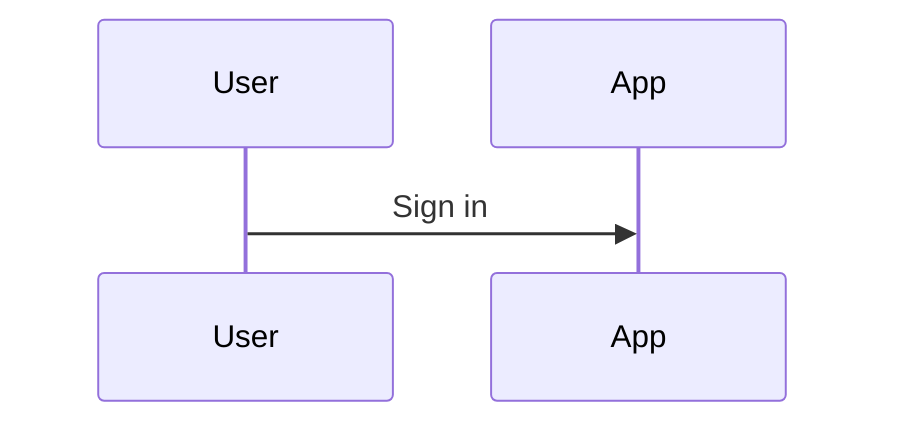

# ostraka

Personal admin base: a small local app for todos, dev logs, ideas, notes and quick sketches, plus a GitLab MR / Jira sprint overview, and a set of agent skills (Claude Code / Cursor) that write daily dev logs from todos, GitLab, Jira, Outlook and Slack activity.

> _Ostraka_: pottery shards used in antiquity for quick notes, sketches and records.

## Run it

Node 24+ and pnpm 10 (`corepack enable`).

    pnpm install
    pnpm build            # builds the web app into apps/web/dist
    pnpm ostraka serve    # http://127.0.0.1:4747

For UI work, run `pnpm ostraka serve` and `pnpm dev` side by side: Vite on http://127.0.0.1:5173 proxies `/api` to the server.

`pnpm ostraka path <todos|notes|devlogs|sketches|people|tags>` prints where that content lives (`OSTRAKA_HOME`, else `contentDir` in `~/.config/ostraka/config.yml`, else `~/ostraka-content`).

`pnpm ostraka todo add "…" [--parent <id>]`, `todo done <id>`, `todo drop <id> [--reason "…"]` and `todo list` change and show Todos and their Sub-todos (`--parent` adds a Sub-todo under that Todo; finishing a Todo finishes its open Sub-todos too); `todo list --finished-on <YYYY-MM-DD>` shows what was done or Dropped that day (add `--json` for agents). In a title, `#tag`, `*high|*med|*low` and `^today|^tomorrow|^fri|^2026-11-05` set the Todo's Tags, priority and due date, as in the app: `ostraka todo add "Fix login #auth *high ^fri"`. MRs and Jira tickets are written as their own tokens, `group/project!<iid>` and `<KEY>-<number>`, and stay in the text as is: `ostraka todo add "Rebase pay/api!809 for PAY-1432"`. The app shows them as chips with their status, from the work overview or fetched on hover. `todos.json` is written only through core (lock, validation, atomic rename), so agents change Todos with the CLI rather than editing the file. The open app refreshes on its own when content changes on disk, and refuses a change made from a copy that is no longer current instead of overwriting it.

The People directory is `people.json`: one Person per colleague, with an id slug, name, aliases, one company email, Slack ID and handle, GitLab username and Jira account ID (and `ignored: true` for someone skills must not offer to add again). Like `todos.json`, it is written only through core, so agents use the CLI: `pnpm ostraka people find <name|id|alias|email|handle>` before looking a colleague up in Slack, Jira, GitLab or M365; `people add "<name>" [--id <id>] [--email …] [--alias …] [--slack-id …] [--slack-handle …] [--gitlab …] [--jira …] [--ignored]`; `people show <id>`; and `people refresh <id> [--email …] [--slack-id …] [--slack-handle …] [--gitlab …] [--jira …]` to record identities looked up again by email (the others stay cached). Each takes `--json`. A Person is mentioned as `@<person id>` in Todos, Notes and Dev logs: `ostraka todo add "Pair with @ilse-vantongeren on PAY-1432"`. The app shows the Person's current name with a contact card, and an id not in the directory as plain text with an offer to add them.

Notes are `notes/<id>.md`: a YAML header, then a Markdown body. The header is validated on load; a Note whose header is broken still shows in the app's list, with the reason. An Idea is a Note tagged `idea`.

```markdown
---
tags: [work, idea] # lowercase, hyphenated; always here, never inline
title: Release plan # optional; otherwise the first `# ` heading names the Note
---

# Release plan
```

Bodies are written in one house style (`-` bullets and rules, `*emphasis*`, `**strong**`, fenced code, `#` headings), which the app's editor writes too, so opening and saving an unchanged Note leaves it byte-identical and the header is never touched. After writing a Note by hand, run `pnpm ostraka note format [<id>…]` to put it in house style; `note list [--json]` lists Notes with any broken header. MR and Jira tokens in a Note or Dev log stay plain text too: the app highlights them in the editor with their status dot and card (as chips in a rendered Dev log), and suggests them while you type `!` or a Jira key like `PAY-`.

Dev logs are `devlogs/<YYYY-MM-DD>.md`, one per day, plus a monthly summary `devlogs/<YYYY-MM>.md`. The Dev log skill writes them: `/devlog` in Claude Code or Cursor gathers today's finished Todos and your GitLab, Jira and Slack activity (through the `GitLab`, `atlassian` and `slack` MCP servers, registered under those names at user level in both editors), shows a draft, and writes and snapshots the day once you confirm it. `pnpm ostraka devlog list [--from <date>] [--to <date>]` lists Dev logs with any broken header, and `pnpm ostraka tag list` the Tags in use (both take `--json`); the app lists them by week under each month's summary, shows any date range stacked by day, and edits a day's body (never its header). Their format, which agents follow, is in [`.claude/skills/devlog/format.md`](.claude/skills/devlog/format.md), next to the skill: a header with `date`, at most 3 `tags`, the `sources` used and `off: true` plus a `label` on an off day, then the sections Done, Meetings & discussions and Notes.

Sketches are `sketches/<id>.md`: a YAML header with a `title` and `tags`, then a body holding one `mermaid` fenced code block, which is what the app's editor changes (anything else in the body is kept). A Sketch without a title or a Mermaid block still shows in the app's list, with the reason. Edit the Mermaid text in place; the open app shows the change live.

````markdown
---
title: Login flow
tags: [auth]
---


````

The content folder is its own git repo (created when missing, no remote). While it runs, the server commits the whole folder as one Snapshot once changes settle: 60 s after the last change, at most every 10 min during steady activity, and on stop. `pnpm ostraka snapshot "<message>"` commits now with that message; skills run it after they write.

History in a Note's or a Sketch's header (and on the Todos view, for `todos.json`) lists the file's Snapshots and shows any of them. Restore writes that version as the current file and commits it as a new Snapshot, `restore: <path> as of <date>`, after committing any changes not yet in a Snapshot; nothing rewrites history, so a restore is undone by restoring the Snapshot before it (the Undo on its toast). The API is `GET /api/history?path=<file>`, `GET /api/history/<commit>?path=<file>` and `POST /api/history/restore {path, commit}`, for any content file.

Search covers Notes, Dev logs and Todos (every state, Sub-todos too) in full text, and Sketches by title and Tags. ⌘K opens it from anywhere in the app: a typed `#tag` or `@person` becomes a chip (several Tags match all of them, or any with the toggle), Kind and Date menus narrow further, and with nothing typed it lists the 8 items opened last (kept in the browser). Notes, Dev logs and Todos each have a search box that narrows the list in place, keeping its order; opening a result lands on the match, highlighted, and a Todo opens expanded, in Done & Dropped if it is finished. `pnpm ostraka search "<words>" [--tag <tag>]… [--kind todo|note|devlog|sketch]… [--from <YYYY-MM-DD>] [--to <YYYY-MM-DD>] [--json]` searches from the terminal, and skills use it instead of `rg` on the content folder. Case and accents are ignored, each word matches as a prefix, `"a phrase"` matches exactly, nothing is stemmed, and a Reference (`PAY-1432`) or Mention (`@jane-doe`) is found only as that whole token. Results rank by relevance (bm25), newer first on a tie. The index is a throwaway SQLite FTS5 file, `~/Library/Caches/ostraka/search.db`, outside the content folder so it is never snapshotted or backed up: the server rebuilds it from the files when it starts (the app shows "indexing…" meanwhile) and keeps it current as files change, whoever changes them. `ostraka search` asks the running server, or builds a throwaway index in memory when the server is down.

`tags.yml` in the content folder holds Tag colours only; Tags themselves come from use. A Tag it doesn't list keeps a colour picked from its name. Colours are `orange`, `yellow`, `green`, `teal`, `blue`, `violet`, `pink` and `red`:

```yaml
code-review:
  color: blue
```

The app's Tags view (the tag icon at the bottom of the rail) lists every Tag in use with its colour and how many Todos, Notes, Dev logs and Sketches use it. From there a Tag can be coloured (saved to `tags.yml`), renamed, merged into another or deleted. A rename, merge or delete rewrites every Todo and Sub-todo and the `tags:` line of every Note, Dev log and Sketch using the Tag, in one request and after a confirmation; files with a broken header are left alone. The next Snapshot holds the whole change, so History undoes it file by file. The API is `GET /api/tags/usage`, `POST /api/tags/<name>/rename {to}`, `POST /api/tags/<name>/merge {into}`, `DELETE /api/tags/<name>` and `PUT /api/tags/<name>/color {color}` (`null` for the default).

## Install it

From the main checkout (not a worktree: the paths written point at this repo):

    pnpm install && pnpm build
    pnpm ostraka install

This writes:

- a LaunchAgent, `~/Library/LaunchAgents/com.ostraka.server.plist`, that runs `ostraka serve` at login and restarts it after a crash. Logs go to `~/Library/Logs/ostraka/server.log`.
- a shim, `~/.local/bin/ostraka`, with absolute paths to node and this repo, so skills and Dock-launched editors find `ostraka` by name. Put `~/.local/bin` on your `PATH` if it isn't.
- a link `~/.claude/skills/<name>` to each skill in this repo's `.claude/skills/`, so the skills work from any project, in Claude Code and in Cursor (which reads `~/.claude/skills/` too). The repo stays their single source: an edit here applies at once. A skill folder of the same name that isn't such a link is left alone, and `install` says so. It also points out the old Cursor `/devlog` command (`~/.cursor/commands/devlog.md`) if it is still there: the `devlog` skill replaces it and its dictation mode.

Run it again after moving the repo or changing Node versions. To remove it: `launchctl bootout gui/$(id -u)/com.ostraka.server`, then delete the files and the skill links.

Then open http://127.0.0.1:4747 and install it as an app, so it gets its own window and Dock icon: in Chrome, ⋮ › Cast, save and share › Install page as app; in Safari, File › Add to Dock.

## Configure it

`~/.config/ostraka/config.yml` holds settings only, never secrets (the app refuses a file with token-like keys or values). Every key is optional; Settings in the app shows what it read.

```yaml
contentDir: ~/ostraka-content # OSTRAKA_HOME overrides it
gitlab:
  base_url: https://gitlab.com
jira:
  site: https://acme.atlassian.net
  cloud_id: 00000000-0000-0000-0000-000000000000 # from https://acme.atlassian.net/_edge/tenant_info
  email: you@acme.com # your Atlassian account; the API token signs in with it
  board_id: 42 # its active sprint is shown
  my_tickets_jql: assignee = currentUser() AND statusCategory != Done
```

## Credentials

Tokens live only in the macOS Keychain. The server reads them once when it starts; besides it, only `ostraka backup` and `ostraka init --from` read one, the push token. Create each item with `-T ""` so that no app is trusted to read it silently: every read, including an agent running `security find-generic-password`, shows a prompt. Expect one prompt per item when the server starts.

Paste each token at the silent `read` prompt. Don't let `security` prompt for it itself (`-w` with no value): that prompt silently truncates long tokens, and Atlassian's are about 190 characters, which then shows up as a bare 401.

- GitLab, a fine-grained personal access token with `read_api`:

      read -rs TOKEN && security add-generic-password -U -a "$USER" -s ostraka-gitlab -T "" -w "$TOKEN"; unset TOKEN

- Jira, a scoped API token with `read:jira-work`, for the account in `jira.email`:

      read -rs TOKEN && security add-generic-password -U -a "$USER" -s ostraka-jira -T "" -w "$TOKEN"; unset TOKEN

- Backup push to the content repo's remote, a GitLab token with `write_repository` on that project:

      read -rs TOKEN && security add-generic-password -U -a "$USER" -s ostraka-push -T "" -w "$TOKEN"; unset TOKEN

`-U` replaces an existing item. Restart the server after changing one: `launchctl kickstart -k gui/$(id -u)/com.ostraka.server`. Never put tokens in `.env`, `~/.zshrc` or `config.yml`.

## Back it up

The content repo is backed up by a plain `git push` of its whole history to a private project in your own namespace on the work gitlab.com (content is work data and colleagues' details, so it stays on employer infrastructure). Create the project empty, then point the content repo at it once:

    git -C ~/ostraka-content remote add origin https://gitlab.com/<you>/ostraka-content.git

- The server pushes after an automatic Snapshot, at most once every 15 minutes, and checks at start that the content is on the remote. `pnpm ostraka backup` pushes now, for instance after an agent's `ostraka snapshot`. Both use the `ostraka-push` Keychain item (macOS prompts on each read) and never prompt for anything else.
- Before each push, every line added since the last backup is scanned for tokens (GitLab `glpat-`, Slack `xox…`, Atlassian `ATATT…`, private keys). A match blocks the push, and the app and `ostraka backup` name the file. Take the secret out of every Snapshot not backed up yet (a secret removed in a later Snapshot is still in history), for example with `git reset --soft` to the last backed-up commit and a new commit.
- It never force-pushes and never merges. If the remote has commits this machine doesn't, the push is rejected, automatic pushes stop and the top bar shows why. Bring them in by hand (`git -C ~/ostraka-content pull --rebase`), then `pnpm ostraka backup`; automatic pushes resume once the content is on the remote.
- "Backed up" means the local `HEAD` is on the remote. The top bar warns when a Snapshot has waited more than 24 hours for a backup, and about any content file over 10 MB (plain git, no LFS).

## Restore on a new machine

1. Clone this repo, then `pnpm install && pnpm build` (Node 24+ and pnpm 10, as in [Run it](#run-it)).
2. `pnpm ostraka init --from https://gitlab.com/<you>/ostraka-content.git`. It walks through recreating the Keychain items ([Credentials](#credentials)), waiting while you run each command in another terminal tab, the push token first; then it clones the content into `~/ostraka-content` (or `OSTRAKA_HOME`) with `origin` set, and writes `~/.config/ostraka/config.yml` with `contentDir` and `gitlab.base_url`, keeping a file that is already there. Fill in the Jira settings ([Configure it](#configure-it)).
3. `pnpm ostraka install` for the LaunchAgent and the CLI shim ([Install it](#install-it)). The server starts, finds the content backed up and carries on pushing from there.
